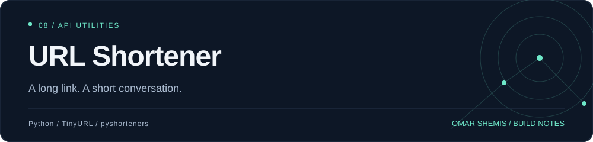

[← Omar’s portfolio](https://github.com/OmarShemis) · [Usage guide](docs/usage.md)

# URL Shortener

A lightweight Python command-line application by Omar Shemis that converts a URL into a shorter TinyURL link using `pyshorteners`.

## Features

- Interactive URL input.
- Link shortening through TinyURL.
- Prints the shortened URL directly in the terminal.
- Dependency versions recorded in `uv.lock`.

## Quick start

Requires **Python 3.13+**, [uv](https://docs.astral.sh/uv/), and internet access.

Run these commands from the project root:

```sh
uv sync --locked
uv run main.py
```

At the `Enter URL:` prompt, paste a full URL including `https://` or `http://`. The application prints the link returned by TinyURL.

This implementation does not require an API key.

## Project structure

```text
url-shortener/
|-- docs/
|   `-- usage.md             # Usage, troubleshooting, and current limitations
|-- src/
|   `-- url_shortener/
|       `-- __init__.py      # Original package scaffold
|-- main.py                 # Working URL-shortening script
|-- pyproject.toml          # Project metadata and dependencies
|-- uv.lock                 # Locked dependency versions
|-- .python-version         # Python version for local tooling
|-- .gitignore              # Local files excluded from Git
`-- README.md
```

The working script remains at the root. The original package scaffold is preserved; the configured `url-shortener` command currently prints a greeting. **Use `uv run main.py` to shorten URLs.**

See the [usage guide](docs/usage.md) for more details.

## Built with

- Python
- [pyshorteners](https://github.com/ellisonleao/pyshorteners)
- [TinyURL](https://tinyurl.com/)

## Current scope

This is a small interactive script. It does not currently implement URL validation, custom aliases, local history, or application-level error handling. Availability depends on the external shortening service.

---

Built by [Omar Shemis](https://github.com/OmarShemis) · [Explore more projects](https://github.com/OmarShemis?tab=repositories)
